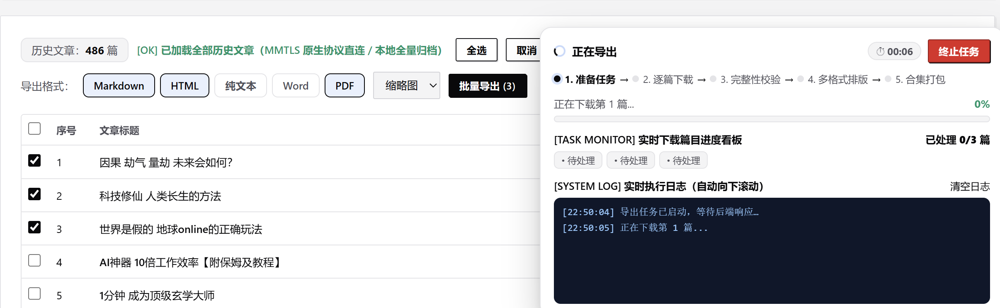

# 博萃 · 微信公众号文章出版归档 (WeChat-Publisher)

  <b>全网前沿技术落地 · 微信公众号全量历史无损归档 · 出版级多格式批量导出 · 链接/标题清单提取</b>

  
  
  
  

---

### 🔑 快速解锁密钥 & 更多平台下载

> **【免费获取激活密钥】**  
> 首次使用导出功能需输入授权码。微信扫码关注作者公众号 **【艺杯羹】**，在后台回复关键词 **`文章`**，即可**免费获取专属激活密钥**（公测默认密钥：`1588`），立即解锁全功能！
>
> **【想下载其他平台？】**  
> 如果您需要批量下载或提纯**其他主流内容平台**（如知乎问答与专栏、微博长文、CSDN 博客、掘金社区、全网任意网页等），欢迎移步作者维护的另一款全网博文提纯神器：  
> 👉 **[yibeigen/wechat-article-exporter: 全网博文批量下载与知识提纯器 · 微信公众号/知乎/微博/CSDN/掘金文章一键导出为 Markdown、PDF、离线网页、Word 与 TXT 电子书 | Blog & WeChat Article Batch Exporter to PDF/Markdown](https://github.com/yibeigen/wechat-article-exporter)**

---

## 💡 项目初衷与开源规划

### 1. 全网前沿技术落地
过去很长一段时间，微信文章批量导出普遍依赖第三方网页版接口（如微信读书等通道），经常遭遇极其苛刻的频控拦截（429 Too Many Requests），动辄封禁 IP 数小时。  
**本项目是全网较早真正基于底层原生协议直连（MMTLS 原生协议直连引擎）落地实现的解决方案**。它直接与微信通信，不借用网页会话，彻底打破了频控冷却和历史文章断层的瓶颈，实现近 10 年全量推文的极速检索与本地归档。

### 2. 拒绝黑灰产倒卖，坚持普惠分享
由于该技术在微信生态中的稀缺性，目前网络上有人将类似机制打包后进行**高价售卖、付费割韭菜**。作者开发此工具的初衷非常纯粹：**将高效率的工具实实在在免费提供给所有真正需要做知识沉淀、公众号文章备份和创作归档的朋友们使用**。

### 3. 公测先行，稳固后正式开源
由于微信底层通信协议及排版解析具有较高的复杂度和动态性，为防止核心接口技术过早被滥用或被黑灰产拿去倒卖，同时也为了集中精力对不同 Windows 环境和多端适配进行兼容性打磨：
* **第一阶段（当前）**：向大家发布 **Windows 免安装便携绿色公测版**（可在右侧 [Releases](https://github.com/yibeigen/WeChat-Publisher/releases) 直接下载即用）。
* **第二阶段（成熟后）**：待底层协议直连与系统架构在各种实际场景下全面经过检验、完全稳定成熟之后，**本项目将正式无保留开放全部源代码**！欢迎大家积极测试并提交 Issue 建议！

---

## ⚡ 核心功能一览

- 🚀 **MMTLS 原生协议直连**：脱离网页端限制，无需扫码授权阅读会话，零频控断点续传。
- 📚 **全量历史推文无损归档**：输入公众号名称或文章链接即可建档，10 年历史推文全量捕获，支持阅读量与点赞数沉淀。
- 🔗 **极速提取链接与标题清单**：
  - **导出链接**：一键导出所有推文 URL，支持一键复制剪贴板与保存为 TXT 文本；
  - **导出标题+链接**：序号、标题与链接格式化排列，方便知识库建立索引。
- 📑 **出版级多格式排版导出**：
  - **Markdown (MD)**：适配 Obsidian / Typora，图片本地化内嵌；
  - **Word (DOCX)**：微软原生可编辑排版，保留标题层级与图文排布；
  - **离线 HTML**：独立单文件离线网页，资源全部内嵌 Base64，断网永久可读；
  - **PDF**：出版级规整页面输出，适合打印珍藏；
  - **纯文本 (TXT)**：干净纯文本流提取，极度契合本地大模型知识库（RAG）喂料。
- 📦 **作者合集自动整理**：按作者与日期分类打包，大篇幅自动科学分卷分册。
- 📡 **私有 RSS 订阅巡检**：为每个收藏公众号生成标准 Feed，支持阅读器即时订阅与增量巡检。

---

## 📖 使用步骤指引

### 步骤一：获取与解压启动
前往 GitHub 仓库右侧 **[Releases](https://github.com/yibeigen/WeChat-Publisher/releases)** 页面，下载最新的 `WeChat-Publisher-Windows-v1.0.zip`，解压后双击 `WeChat-Publisher.exe` 或 `双击启动.bat`，即可在浏览器中自动进入管理工作台（默认 `http://127.0.0.1:5200`）：

---

### 步骤二：添加公众号与全量同步
在管理界面输入目标公众号名称或粘贴一篇推文链接，点击「查看文章」，进入文章列表管理。点击顶部「立即同步推文」，MMTLS 原生直连引擎将快速拉取该公众号全部历史文章与互动数据：

---

### 步骤三：多格式批量导出与链接提取
1. **多格式导出**：勾选所需文章（支持全选/反选/即时关键词过滤），选择导出格式（Markdown / HTML / Word / PDF / TXT），点击「批量导出」。
2. **提取链接与清单**：
   - 点击 **「导出链接」**：一键生成纯 URL 清单；
   - 点击 **「导出标题+链接」**：一键生成序号+标题+链接完整清单；
   - 弹窗内支持 **📋 一键复制全部** 或 **💾 下载 TXT 文本**。

---

### 步骤四：扫码免费获取密钥激活
首次使用导出功能或点击顶部「🔑 软件激活」按钮时，会拉起激活窗口：
1. 微信扫码关注官方公众号 **【艺杯羹】**；
2. 后台回复关键词 **`文章`**，即可免费获取专属激活密钥（默认：`1588`）；
3. 输入密钥点击「立即激活」，即可永久解锁全部导出与归档权限！

---

## 👨‍💻 作者与联系方式

- **软件作者**：艺杯羹 (@yibeigen)
- **微信公众号**：**艺杯羹**（微信搜索关注，后台回复关键词获取技术支持）
- **联系 QQ**：`3057454077`
- **CSDN 博客**：[艺杯羹的 CSDN 技术博客](https://blog.csdn.net/qq_46987323?spm=1000.2115.3001.5343)
- **个人主页**：[https://yibeigen.pages.dev/](https://yibeigen.pages.dev/)
- **GitHub 主页**：[@yibeigen](https://github.com/yibeigen)

欢迎各位在 Issues 中交流反馈或提出新功能建议！

---

## ⚖️ 免责声明

1. 本工具仅供个人学习研究、离线数据备份与合法知识管理使用，严禁用于任何商业牟利、黑灰产滥用或侵犯原创作者版权之行为。
2. 使用本工具抓取文章内容时，请务必严格遵守相关平台的服务协议及法律法规。
3. 因使用者不当操作或滥用引发的一切法律纠纷，均由使用者本人承担。
4. 本项目基于 MIT 许可证开源。
