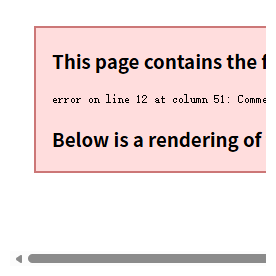
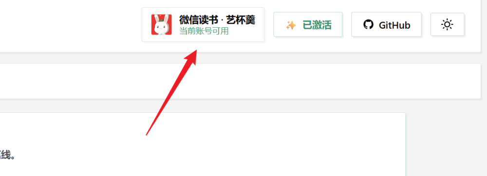
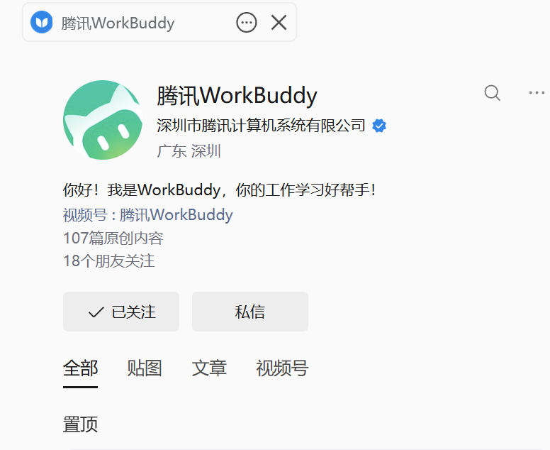
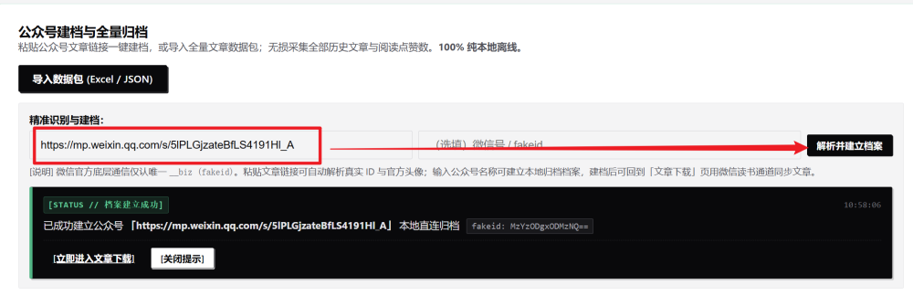
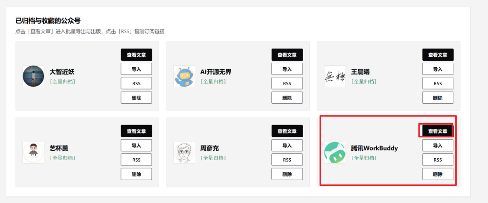
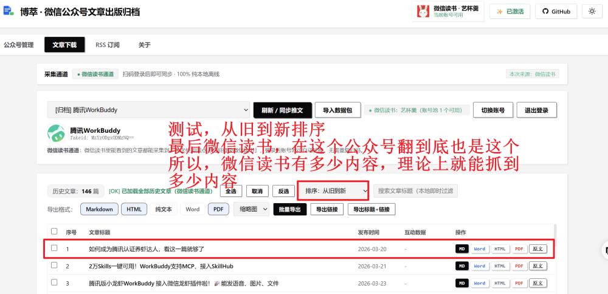
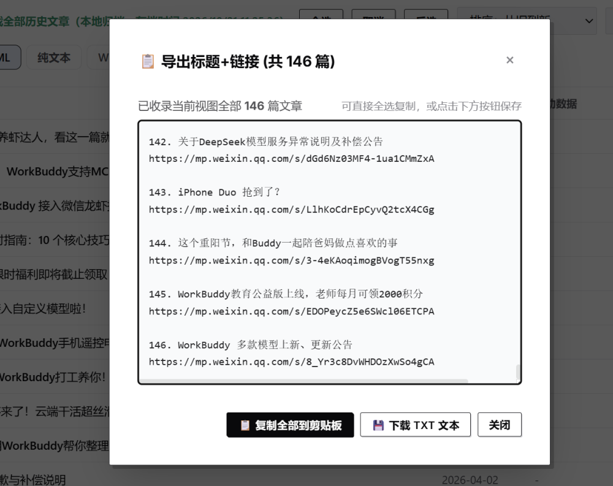

<p align="center">
  
</p>

<p align="center">
  <b>微信公众号历史文章批量归档 · 出版级多格式导出 · 链接/标题清单提取</b>
</p>

<p align="center">
  <a href="https://github.com/yibeigen/WeChat-Publisher/releases"></a>
  <a href="https://github.com/yibeigen/WeChat-Publisher/releases"></a>
  <a href="#-作者与社区交流"></a>
  <a href="https://github.com/yibeigen/WeChat-Publisher/blob/master/LICENSE"></a>
  <a href="https://blog.csdn.net/qq_46987323?spm=1000.2115.3001.5343"></a>
  <a href="https://yibeigen.pages.dev/"></a>
</p>

---

> [!IMPORTANT]
> **✅ 微信公众号全量历史文章批量导出已正式可用（不再是"修复中"）**
>
> 早期方案依赖本地代理嗅探微信客户端通道，在微信 4.x 切换为私有 Native iLink 通道后失效。本版已改用**微信读书通道**重新实现：登录自己的微信读书账号后，即可对目标公众号做**整号历史文章全量归档**，并批量导出为 Markdown / PDF / Word / TXT / 离线网页。
>
> - **项目仓库**：https://github.com/yibeigen/WeChat-Publisher
> - **下载地址**：[Releases（Windows 安装版 / 绿色版 · macOS 双架构版）](https://github.com/yibeigen/WeChat-Publisher/releases)

---

### 🔑 快速解锁密钥 & 更多平台下载

> **【免费获取激活密钥】**  
> 首次使用导出功能需输入授权码。微信扫码关注作者公众号 **【艺杯羹】**，在后台回复关键词 **`文章`**，即可**免费获取专属激活密钥**，立即解锁全功能！
>
> **【加入官方交流群】**  
> 欢迎扫码加入微信交流群交流使用体验、反馈建议与获取更新：[👉 点击直达文末交流群二维码](#-作者与社区交流)
>
> **【想下载其他平台？】**  
> 如果您需要批量下载或提纯**其他主流内容平台**（如知乎问答与专栏、微博长文、CSDN 博客、掘金社区、全网任意网页等），欢迎移步作者维护的另一款全网博文提纯神器：  
> 👉 **[yibeigen/wechat-article-exporter: 全网博文批量下载与知识提纯器 · 微信公众号/知乎/微博/CSDN/掘金文章一键导出为 Markdown、PDF、离线网页、Word 与 TXT 电子书 | Blog & WeChat Article Batch Exporter to PDF/Markdown](https://github.com/yibeigen/wechat-article-exporter)**

---

## 📖 使用步骤指引

### 准备工作：下载与启动
前往 GitHub 仓库右侧 **[Releases](https://github.com/yibeigen/WeChat-Publisher/releases)** 页面，按需任选其一：

**Windows 版**

- **安装版（推荐）**：下载 `WeChat-Publisher-Setup-v1.0.2.exe`，双击按向导安装即可，自动创建开始菜单/桌面快捷方式；**升级版本直接双击新安装包覆盖安装**，文章数据与配置自动保留，支持一键卸载。
- **免安装绿色版**：下载 `WeChat-Publisher-Windows-v1.0.2.zip`，解压后双击 `WeChat-Publisher.exe` 或 `双击启动.bat`；升级时将新压缩包解压覆盖到原目录即可（`data/` 数据文件夹请勿删除）。

**macOS 版（macOS 11.0 及以上）**

- **Apple Silicon（M1/M2/M3/M4）**：下载 `WeChat-Publisher-macOS-Lite-arm64-v1.0.2.dmg`
- **Intel 芯片**：下载 `WeChat-Publisher-macOS-Lite-x86_64-v1.0.2.dmg`
- 同目录另附同名 `.zip` 压缩包，解压后可直接得到 `WeChat-Publisher.app`。

安装方式：打开 dmg，把 `WeChat-Publisher.app` 拖入「应用程序」文件夹即可。由于安装包未使用 Apple 开发者证书签名，**首次启动请按住 Control 点击图标 → 选择「打开」→ 再点一次「打开」**；若仍被系统拦截，可在终端执行一次：

```bash
xattr -cr /Applications/WeChat-Publisher.app
```

macOS 版的数据与配置保存在 `~/Library/Application Support/WeChat MP Tools`，升级时替换 App 即可，数据不会丢失。

两种平台启动后都会自动在浏览器打开管理工作台（默认 `http://127.0.0.1:5200`）：


---

### 第一步：登录微信读书
打开管理界面右上角的账号状态区，确认显示「**微信读书 · 你的账号**　当前账号可用」。
若尚未登录，点击该区域按提示完成微信读书登录 —— 这是后续所有文章采集的前提。



> 本项目只读取你用自己账号在微信读书里本来就能看到的公众号内容，不保存你的账号密码。

---

### 第二步：粘贴推文链接，解析并建立档案
先在微信里打开目标公众号，复制其任意一篇文章的链接（形如 `https://mp.weixin.qq.com/s/xxxxxxxx`）：



回到管理界面的「公众号建档与全量归档」区域，把链接粘贴到输入框，点击「**解析并建立档案**」。
程序会自动解析出该公众号的真实标识（fakeid）、头像与昵称，并写入本地档案库：



建档成功后，可在「已归档与收藏的公众号」卡片列表中看到它；点击「**查看文章**」即可进入文章下载页：



---

### 第三步：进入文章下载页，同步推文
在「文章下载」页顶部的公众号下拉框中选中目标公众号，点击「**刷新 / 同步推文**」。
程序会通过微信读书通道逐页拉取该公众号的历史文章，**每抓完一页就即时写入本地档案**，中途刷新页面或切换公众号都不会丢失已抓到的进度：



> **关于抓取范围**：能抓到多少，取决于微信读书里该公众号能翻到多少。实测把微信读书翻到底，与本工具同步到底的结果一致 —— 也就是说，微信读书里有多少内容，理论上就能抓到多少内容。
>
> **关于频率限制**：短时间内反复同步可能触发服务端限流（界面会提示稍后再试）。遇到时请等待一段时间再点「重新加载」，不要连续点击。

---

### 第四步：先导出文章链接做备份（推荐）
同步完成后，建议先点一次「**导出标题+链接**」，把当前视图下的全部文章标题与 URL 保存到本地 TXT。
这样即使后续重新同步、切换账号或更换电脑，手里也始终有一份完整的链接清单可以随时对照恢复：



弹窗内支持「**复制全部到剪贴板**」与「**下载 TXT 文本**」两种方式。

---

### 第五步：多格式批量导出
勾选所需文章（支持全选 / 反选 / 即时关键词过滤），选择导出格式后点击「**批量导出**」：

- **Markdown (MD)**：适配 Obsidian / Typora，图片本地化内嵌；
- **Word (DOCX)**：保留标题层级与图文排布，可直接编辑；
- **离线 HTML**：单文件离线网页，资源内嵌，断网可读；
- **PDF**：规整页面输出，适合打印珍藏；
- **纯文本 (TXT)**：干净文本流，适合喂给本地大模型知识库。

---

### 附：扫码免费获取密钥激活
首次使用导出功能或点击顶部「🔑 软件激活」按钮时，会拉起激活窗口：
1. 微信扫码关注官方公众号 **【艺杯羹】**；
2. 后台回复关键词 **`文章`**，即可免费获取专属激活密钥；
3. 输入密钥点击「立即激活」，即可永久解锁全部导出与归档权限！


---

## 💡 项目初衷与开源规划

### 1. 通道策略：统一走微信读书，专注稳定可用
微信文章批量导出过去常见两种做法：一是直接抓网页会话，容易触发频控、动辄冷却数小时；二是依赖对客户端底层的逆向对接，环境依赖重、维护成本高、在不同电脑上容易水土不服。  
**本项目当前统一采用「微信读书通道 + 本地归档」方案**：在程序内登录一次自己的微信读书账号后，即可按公众号批量拉取其可见的历史文章；抓到的结果会即时写入本地档案，后续翻页和二次打开都直接读本地，既不会重复请求，也不会因为中途刷新页面而丢失进度。

### 2. 拒绝黑灰产倒卖，坚持普惠分享
由于公众号批量归档能力在微信生态中的稀缺性，目前网络上有人将类似机制打包后进行**高价售卖、付费割韭菜**。作者开发此工具的初衷非常纯粹：**将高效率的工具实实在在免费提供给所有真正需要做知识沉淀、公众号文章备份和创作归档的朋友们使用**。

### 3. 公测先行，稳固后正式开源
由于公众号文章排版解析与采集适配具有较高的复杂度和动态性，为防止核心接口技术过早被滥用或被黑灰产拿去倒卖，同时也为了集中精力对不同 Windows / macOS 环境和多端适配进行兼容性打磨：
* **第一阶段（当前）**：向大家发布 **Windows 安装版 / 免安装便携绿色版** 与 **macOS 版（Apple Silicon / Intel 双架构）**（均可在右侧 [Releases](https://github.com/yibeigen/WeChat-Publisher/releases) 直接下载即用）。
* **第二阶段（成熟后）**：待采集通道与系统架构在各种实际场景下全面经过检验、完全稳定成熟之后，**本项目将正式无保留开放全部源代码**！欢迎大家积极测试并提交 Issue 建议！

---

## ⚡ 核心功能一览

- 🚀 **微信读书通道采集**：登录一次自己的微信读书账号，即可按公众号批量拉取历史文章，无需在多个网页间来回切换。
- 📚 **历史推文批量归档**：粘贴任意一篇推文链接即可自动解析公众号并建档，微信读书中可见的历史推文尽数捕获，支持阅读量与点赞数沉淀。
- 🔗 **极速提取链接与标题清单**：
  - **导出链接**：一键导出所有推文 URL，支持一键复制剪贴板与保存为 TXT 文本；
  - **导出标题+链接**：序号、标题与链接格式化排列，方便知识库建立索引。
- 📑 **出版级多格式排版导出**：
  - **Markdown (MD)**：适配 Obsidian / Typora，图片本地化内嵌；
  - **Word (DOCX)**：微软原生可编辑排版，保留标题层级与图文排布；
  - **离线 HTML**：独立单文件离线网页，资源全部内嵌 Base64，断网永久可读；
  - **PDF**：出版级规整页面输出，适合打印珍藏；
  - **纯文本 (TXT)**：干净纯文本流提取，极度契合本地大模型知识库（RAG）喂料。
- 📦 **作者合集自动整理**：按作者与日期分类打包，大篇幅自动科学分卷分册。
- 📡 **私有 RSS 订阅巡检**：为每个收藏公众号生成标准 Feed，支持阅读器即时订阅与增量巡检。

---

## 👨‍💻 作者与社区交流

欢迎微信扫码加入官方交流群，与作者面对面交流反馈、提出新功能建议，或获取最新公测版本更新提醒：

<p align="center">
  
  <br>
  <sub><b>博萃 · 文章导出微信交流群</b>（如群满或二维码过期，可添加作者 QQ: 3057454077 拉群）</sub>
</p>

- **软件作者**：艺杯羹 (@yibeigen)
- **微信公众号**：**艺杯羹**（微信搜索关注，后台回复关键词「文章」获取专属激活密钥）
- **联系 QQ**：`3057454077`
- **CSDN 博客**：[艺杯羹的 CSDN 技术博客](https://blog.csdn.net/qq_46987323?spm=1000.2115.3001.5343)
- **个人主页**：[https://yibeigen.pages.dev/](https://yibeigen.pages.dev/)
- **GitHub 主页**：[@yibeigen](https://github.com/yibeigen)

欢迎各位在 Issues 中交流反馈或提出新功能建议！

---

## ⚖️ 免责声明

1. 本工具仅供个人学习研究、离线数据备份与合法知识管理使用，严禁用于任何商业牟利、黑灰产滥用或侵犯原创作者版权之行为。
2. 使用本工具抓取文章内容时，请务必严格遵守相关平台的服务协议及法律法规。
3. 因使用者不当操作或滥用引发的一切法律纠纷，均由使用者本人承担。
4. 本项目基于 MIT 许可证开源。
